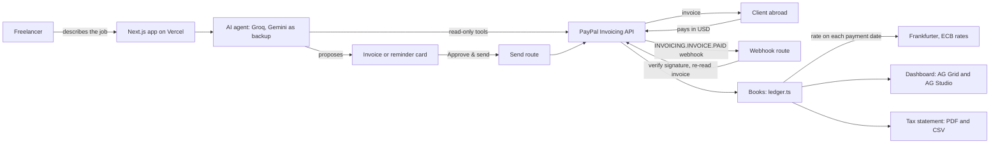

<p align="center">
  
</p>

# Crossbill

**Describe the job. Approve. Get paid. Your tax books keep themselves.**

Crossbill is an AI agent for freelancers paid by overseas clients. Describe the job in plain words and it drafts a PayPal invoice, sends it once you approve, chases late payers, and keeps tax-ready books in your own currency, converting every payment at the exchange rate on the day you were paid.

- **Live demo:** https://crossbill-agent.vercel.app (no sign-up, no access code, no cold start)
- **Demo video (2:46):** https://youtu.be/74J9ANQp7qw
- **Built for:** the [PayPal AI Hackathon](https://paypalaihackathon.devpost.com/), running on the PayPal **sandbox** (no real money moves)

## Try it in 3 minutes (for judges)

1. Open **https://crossbill-agent.vercel.app** and type:
   > Invoice paypal.com (paypalhackathon@personal.example.com) for my participation in the "What's next with AI + PayPal?" hackathon at $380 per day for 4 days
2. Check the invoice card, then tap **Approve & send**. Crossbill creates the invoice in PayPal and sends it.
3. Tap **Open the client's payment page** and log in as the test client:

   | Sandbox buyer (client) | |
   | --- | --- |
   | Email | `paypalhackathon@personal.example.com` |
   | Password | `T&f$4#&u` |

   Pay the invoice with the buyer's PayPal balance.
4. Back in Crossbill, ask **"Who owes me and who has paid?"** The invoice now shows as PAID, with its rand value at that day's rate.
5. Open **Dashboard**: every invoice in an AG Grid table, and a ready-made AG Studio report (totals, rand per month, rand per client) that you can reshape with **Edit report**.
6. Open **Statement**: this tax year's income, payment by payment, in USD and rand. Tap **Download PDF** or **Download CSV**.
7. Try a reminder: **"Draft a polite reminder for my oldest unpaid invoice"**, then **Approve & send**.

## The problem

PayPal can't invoice in South African rand, so freelancers here (and in many other countries) bill overseas clients in US dollars. That means writing invoices by hand, chasing late payers by email, and at tax time converting every single payment into rand at the right exchange rate, usually in a spreadsheet kept on the side.

## What it does

| Feature | How |
| --- | --- |
| Plain words to invoice | The AI turns "8 maths lessons at $20 each" into a structured PayPal invoice with the right units |
| You approve every send | The AI only proposes; nothing reaches PayPal until you tap **Approve & send** |
| Who owes you | Ask in plain words; the agent reads your invoices from PayPal, including overdue days |
| Chase late payers | The agent drafts a polite, specific reminder; you approve it and PayPal sends it |
| Books in your currency | Every payment (each part-payment too) is converted at the exchange rate for the day it was paid, and a verified PayPal webhook confirms each payment the moment it lands |
| Tax-year statement | `/statement`: the South African tax year (1 March to end of February), a month or any range; monthly totals; every payment with its rate; PDF and CSV downloads |
| Ask about earnings | "What did I earn in October?" or "How much did I earn this tax year, in rand?" |
| Receivables dashboard | An [AG Grid](https://www.ag-grid.com/) table of every invoice plus [AG Studio](https://www.ag-grid.com/studio/) reports over invoices and payments |
| Any local currency | Rand by default; about 30 currencies from European Central Bank rates (INR, PHP, BRL, MXN...), plus currencies such as KES and NGN from community rates |
| Talks like a helper | Greetings, vague or off-topic messages get a short, polite answer, a follow-up question and the example prompts as buttons; missing invoice details are asked for, never guessed |
| Phone-ready app | Works on a 320-pixel screen, installs as an app, and shows a clear offline page when the connection drops |

## Why the rate on the day you were paid

For South African individuals, foreign income is translated into rand at the spot rate on the date it is received; that is the default rule in [SARS Interpretation Note 63](https://www.sars.gov.za/lapd-intr-in-2012-63-rules-translation-amounts-foreign-currencies) (section 25D of the Income Tax Act). Individuals may instead elect the [average exchange rate](https://www.sars.gov.za/legal-pub-aer-01-average-exchange-rates-specific-provisions-income-tax-act) for the year of assessment. Crossbill records the payment-date rate for every payment, and shows the rate's own date (on weekends and public holidays the European Central Bank publishes no rate, so the last working day's rate is used).

Crossbill keeps records; it is not tax advice.

## Who it's for

Any freelancer paid from abroad: tutors, translators, designers, writers, virtual assistants, photographers, consultants and developers. Crossbill bills by the hour (`HOURS`), per item such as lessons, words or days (`QUANTITY`), or as a flat fee (`AMOUNT`), using PayPal's own units of measure.

## How it works



1. The agent has six tools: `propose_invoice`, `list_invoices`, `earnings`, `income_statement`, `propose_reminder` and `show_examples`. It can **read** from PayPal and **propose** actions, but it cannot send anything. For a greeting, a vague request or something outside its job, it answers in a sentence or two, asks what you need, and shows the example prompts as buttons.
2. Sending happens in separate routes (`/api/invoices/send`, `/api/invoices/remind`) that run only when you tap Approve. The approval step is enforced in code, not just in the prompt.
3. When a client pays, PayPal calls `/api/paypal/webhook`. Crossbill asks PayPal to verify the signature, re-reads the invoice from PayPal for the authoritative amount, and converts it at that day's rate.
4. The books (`lib/ledger.ts`) are rebuilt live from PayPal on every request: no database to drift out of sync or pause. Each payment gets the rate for its own date; past rates are cached.
5. Every money figure the agent quotes comes from a tool result, already formatted; the model never does currency arithmetic itself.

## PayPal integration

| PayPal API | Used for |
| --- | --- |
| `POST /v2/invoicing/generate-next-invoice-number` | Sequential invoice numbers |
| `POST /v2/invoicing/invoices` | Create the draft invoice (idempotent `PayPal-Request-Id`, your business name as invoicer) |
| `POST /v2/invoicing/invoices/{id}/send` | Send it to the client after approval |
| `GET /v2/invoicing/invoices` and `/{id}` | Status, amounts due, payment transactions and dates |
| `POST /v2/invoicing/invoices/{id}/remind` | Payment reminders after approval |
| Webhook `INVOICING.INVOICE.PAID` | Real-time payment confirmation |
| `POST /v1/notifications/verify-webhook-signature` | Only trust webhooks PayPal confirms |

## AI tools used and how

| Tool | Role |
| --- | --- |
| [Vercel AI SDK](https://ai-sdk.dev/) | Tool calling and multi-step agent loop (`lib/agent.ts`) |
| Groq, model `openai/gpt-oss-120b` | Main model: reads the freelancer's message and calls the tools |
| Google Gemini, model `gemini-3.8-flash` | Automatic backup: takes over instantly if Groq fails or hits its free quota |

Both run on free tiers. The model order and names are set by environment variables, so a retired or overloaded model can be swapped without code changes.

## How we used AG Grid and AG Studio

- **AG Grid** (`components/receivables.tsx`): every invoice with status chips, overdue highlighting, due and paid dates, the payment day's rate and the local-currency value; sortable, filterable and themed to match the app.
- **AG Studio** (`components/studio-reports.tsx`): two related data sources, `invoices` and `payments` (one row per payment, with `paid_month`, `paid_usd`, the rate and the local value). It opens on a ready-made report, and **Edit report** lets any freelancer add KPIs, charts and pivots in the browser; their report is kept in that browser.

## Safety

- Human approval before any invoice or reminder is sent
- On the sandbox, invoices and reminders only go to the listed test client accounts (`SANDBOX_TEST_EMAILS`). PayPal has no API to check whether an email belongs to a PayPal account, so anything else is refused before it reaches PayPal, both when the agent drafts it and when you approve
- Webhooks are accepted only after PayPal verifies their signature
- One request id per invoice card, so a double tap can never create two invoices
- Per-IP rate limits on every route, including the webhook, with size limits on what each route accepts
- Strict input validation (zod) on every request, and invoice ids checked before they reach a PayPal URL
- Security headers on every response: a content security policy, no framing, no MIME sniffing, HTTPS only
- No known vulnerabilities in production dependencies (`npm audit`)
- Secrets live only in environment variables; `.env.local` is git-ignored, and nothing secret reaches the browser

## Accessibility

- Checked with [axe](https://github.com/dequelabs/axe-core) on every page and mid-conversation: no violations
- Keyboard first: a "Skip to content" link, visible focus rings, Enter to send and Shift+Enter for a new line
- Screen readers hear each new reply (the conversation is a live region), and every page has proper headings
- Text meets WCAG AA contrast, and animations stop for people who ask for reduced motion

## Run it locally

Requirements: Node.js 20.9 or newer.

```bash
npm install
cp .env.example .env.local   # on Windows: copy .env.example .env.local
# fill in .env.local with your own keys
npm run dev
```

Open http://localhost:3000.

### Environment variables

| Variable | Where to get it |
| --- | --- |
| `PAYPAL_CLIENT_ID`, `PAYPAL_CLIENT_SECRET` | [PayPal Developer](https://developer.paypal.com/dashboard/applications/sandbox) > Apps & Credentials > Sandbox |
| `PAYPAL_API_BASE` | Optional, default `https://api-m.sandbox.paypal.com` (the sandbox); use `https://api-m.paypal.com` for live PayPal |
| `PAYPAL_WEBHOOK_ID` | Shown after you add a webhook for **Invoicing invoice paid** on the same sandbox app |
| `SANDBOX_TEST_EMAILS` | Your sandbox **personal** (client) account emails, comma-separated. Only these can receive invoices on the sandbox |
| `GROQ_API_KEY` | [Groq console](https://console.groq.com/keys) (free) |
| `GOOGLE_GENERATIVE_AI_API_KEY` | [Google AI Studio](https://aistudio.google.com/apikey) (free) |
| `AI_PROVIDER_ORDER` | Optional, default `groq,gemini` |
| `GROQ_MODEL`, `GEMINI_MODEL` | Optional, defaults `openai/gpt-oss-120b` and `gemini-3.8-flash` |
| `DEFAULT_PAYMENT_TERM` | Optional, default `NET_15`; or `DUE_ON_RECEIPT`, `NET_10`, `NET_30` |
| `LOCAL_CURRENCY` | Optional, default `ZAR`; any ISO code, e.g. `INR`, `PHP`, `KES` |
| `BUSINESS_NAME` | Optional: the name clients see on your invoices and statement |

## Project structure

| Path | What it does |
| --- | --- |
| `lib/agent.ts` | AI agent: system prompt, six tools, provider fallback |
| `lib/examples.ts` | The example prompts, shared by the chat and the agent |
| `lib/paypal.ts` | PayPal REST client: invoicing and webhook verification |
| `lib/recipients.ts` | Sandbox allowlist: which test client emails may receive invoices |
| `lib/ledger.ts` | Books built live from PayPal: amounts due, every payment, its rate and local value, overdue days |
| `lib/fx.ts` | USD to local-currency rates on a given day: [Frankfurter](https://www.frankfurter.app/) (ECB), with [exchange-api](https://github.com/fawazahmed0/exchange-api) as fallback |
| `lib/statement.ts` | Income statement for a period, and its CSV |
| `lib/statement-pdf.ts` | The statement as an A4 PDF, built on the server |
| `lib/money.ts` | Money and date formatting, South African tax years |
| `app/api/chat` | Chat endpoint |
| `app/dashboard`, `app/api/ledger` | Receivables dashboard (AG Grid and AG Studio) and its read-only data |
| `app/statement`, `app/api/statement` | Tax statement page, plus JSON, CSV and PDF |
| `app/api/invoices/send`, `remind` | Run only on Approve |
| `app/api/paypal/webhook` | Verified payment webhook |
| `components/` | Chat, approval cards, dashboard, reports, statement, logo, landing animation |
| `public/sw.js`, `public/offline.html` | Service worker that shows the offline page; it caches nothing else |
| `next.config.ts` | Security headers |
| `app/icon.svg`, `app/apple-icon.png`, `public/icons/` | Favicon and app icons |
| `public/crossbill-logo.svg` | The full logo, used at the top of this README |

## What's next

- Live mode for real PayPal accounts
- The optional average-rate method for the tax year
- Saved clients and default rates
- Sharing the statement with an accountant

## License

[MIT](LICENSE)
