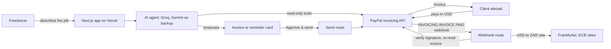

# Crossbill

**Describe the job. Approve. Get paid.**

Crossbill is an AI agent for freelancers paid by overseas clients. Describe the job in plain words and it drafts a PayPal invoice, sends it once you approve, chases late payers, and records every payment in rand.

- **Live demo:** https://crossbill-agent.vercel.app
- **Built for:** the [PayPal AI Hackathon](https://paypalaihackathon.devpost.com/), running on the PayPal **sandbox** (no real money moves)

## Try it in 2 minutes (for judges)

No sign-up needed.

1. Open **https://crossbill-agent.vercel.app** and type (or tap the matching example):
   > Invoice Sarah Lee (sb-0dyw4353715522@personal.example.com) for 2 hours of tutoring at $25 an hour
2. Check the invoice card, then tap **Approve & send**. Crossbill creates the invoice in PayPal and sends it.
3. Tap **Open the client's payment page** and log in as the test client:

   | Sandbox buyer (client) | |
   | --- | --- |
   | Email | `sb-0dyw4353715522@personal.example.com` |
   | Password | `<<ADD BUYER PASSWORD>>` |

   Pay the invoice with the buyer's PayPal balance.
4. Back in Crossbill, ask **"Who owes me and who has paid?"** The invoice now shows as PAID.
5. Try a reminder: **"Draft a polite reminder for my oldest unpaid invoice"**, then **Approve & send**.

## The problem

PayPal can't price in South African rand, so freelancers here (and in many other countries) bill overseas clients in US dollars. That means writing invoices by hand, chasing late payers by email, and keeping a separate spreadsheet of what each payment was worth in local currency for the tax return.

## What it does

| Feature | How |
| --- | --- |
| Plain words to invoice | The AI turns "8 maths lessons at $20 each" into a structured PayPal invoice with the right units |
| You approve every send | The AI only proposes; nothing reaches PayPal until you tap **Approve & send** |
| Who owes you | Ask in plain words; the agent reads your invoices from PayPal |
| Chase late payers | The agent drafts a polite, specific reminder; you approve it and PayPal sends it |
| Payments in rand | When a client pays, a verified PayPal webhook records the payment with its rand value at that day's exchange rate |

## Who it's for

Any freelancer paid from abroad: tutors, translators, designers, writers, virtual assistants, photographers, consultants and developers. Crossbill bills by the hour (`HOURS`), per item such as lessons, words or days (`QUANTITY`), or as a flat fee (`AMOUNT`), using PayPal's own units of measure.

## How it works



1. The agent has three tools: `propose_invoice`, `list_invoices` and `propose_reminder`. It can **read** from PayPal and **propose** actions, but it cannot send anything.
2. Sending happens in separate routes (`/api/invoices/send`, `/api/invoices/remind`) that run only when you tap Approve. The approval step is enforced in code, not just in the prompt.
3. When a client pays, PayPal calls `/api/paypal/webhook`. Crossbill asks PayPal to verify the signature, re-reads the invoice from PayPal for the authoritative amount, and converts it to rand at that day's rate.

## PayPal integration

| PayPal API | Used for |
| --- | --- |
| `POST /v2/invoicing/generate-next-invoice-number` | Sequential invoice numbers |
| `POST /v2/invoicing/invoices` | Create the draft invoice (with an idempotent `PayPal-Request-Id`) |
| `POST /v2/invoicing/invoices/{id}/send` | Send it to the client after approval |
| `GET /v2/invoicing/invoices` and `/{id}` | "Who owes me", invoice status, paid amounts |
| `POST /v2/invoicing/invoices/{id}/remind` | Payment reminders after approval |
| Webhook `INVOICING.INVOICE.PAID` | Real-time payment records |
| `POST /v1/notifications/verify-webhook-signature` | Only trust webhooks PayPal confirms |

## AI tools used and how

| Tool | Role |
| --- | --- |
| [Vercel AI SDK](https://ai-sdk.dev/) | Tool calling and multi-step agent loop (`lib/agent.ts`) |
| Groq, model `openai/gpt-oss-120b` | Main model: reads the freelancer's message and calls the tools |
| Google Gemini, model `gemini-3.8-flash` | Automatic backup: takes over instantly if Groq fails or hits its free quota |

Both run on free tiers. The model order and names are set by environment variables, so a retired or overloaded model can be swapped without code changes.

## Safety

- Human approval before any invoice or reminder is sent
- Webhooks are accepted only after PayPal verifies their signature
- One request id per invoice card, so a double tap can never create two invoices
- Per-IP rate limits on every route
- Secrets live only in environment variables; `.env.local` is git-ignored

## Run it locally

Requirements: Node.js 20.9 or newer.

```bash
npm install
cp .env.example .env.local   # on Windows: copy .env.example .env.local
# fill in .env.local with your own keys
npm run dev
```

Open http://localhost:3000.

### Environment variables

| Variable | Where to get it |
| --- | --- |
| `PAYPAL_CLIENT_ID`, `PAYPAL_CLIENT_SECRET` | [PayPal Developer](https://developer.paypal.com/dashboard/applications/sandbox) > Apps & Credentials > Sandbox |
| `PAYPAL_WEBHOOK_ID` | Shown after you add a webhook for **Invoicing invoice paid** on the same sandbox app |
| `GROQ_API_KEY` | [Groq console](https://console.groq.com/keys) (free) |
| `GOOGLE_GENERATIVE_AI_API_KEY` | [Google AI Studio](https://aistudio.google.com/apikey) (free) |
| `AI_PROVIDER_ORDER` | Optional, default `groq,gemini` |

## Project structure

| Path | What it does |
| --- | --- |
| `lib/agent.ts` | AI agent: system prompt, tools, provider fallback |
| `lib/paypal.ts` | PayPal REST client: invoicing and webhook verification |
| `lib/fx.ts` | USD to ZAR rates from [Frankfurter](https://www.frankfurter.app/) |
| `app/api/chat` | Chat endpoint |
| `app/api/invoices/send`, `remind` | Run only on Approve |
| `app/api/paypal/webhook` | Verified payment webhook |
| `components/` | Chat and approval cards |

## What's next

- Saved payment history in Supabase, with a monthly income statement in USD and ZAR
- Receivables dashboard
- Client memory and default rates per freelancer
- Live mode, more local currencies, accountant export

## License

[MIT](LICENSE)
