<p align="center">
  
</p>

# How Crossbill works

Crossbill is one Next.js app on Vercel. A freelancer describes a job in plain words, an AI agent turns it into a PayPal invoice draft, and nothing is sent until the freelancer taps **Approve & send**. When the client pays, PayPal calls a verified webhook, and the books rebuild themselves from PayPal, with every payment converted at the exchange rate for the day it was paid.

<p align="center">
  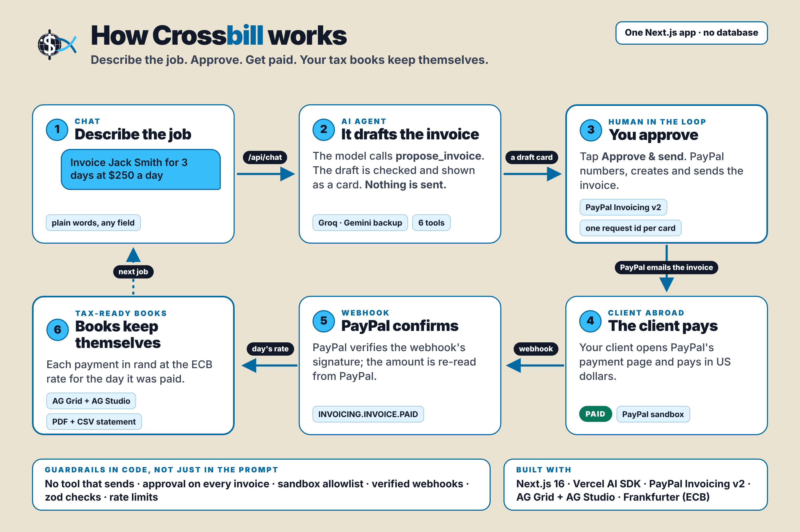
</p>

This page explains how every part connects, with diagrams and the code behind each step. Every source file also opens with a short header (what it does, how it connects, key ideas), so you can go from a diagram straight to the code.

| | |
| --- | --- |
| **Live demo** | https://crossbill-agent.vercel.app (the test login is in the [README](../README.md#try-it-in-3-minutes-for-judges)) |
| **Demo video** | https://youtu.be/74J9ANQp7qw (2:46) |
| **In numbers** | 3 pages · 6 API routes · 6 agent tools · 8 PayPal REST calls + 1 webhook event · 3 AI models from 2 providers · 0 databases |

## Contents

1. [For judges: where to find each criterion](#1-for-judges-where-to-find-each-criterion)
2. [The big picture](#2-the-big-picture)
3. [The code map](#3-the-code-map)
4. [Flow 1: from plain words to a draft invoice](#4-flow-1-from-plain-words-to-a-draft-invoice)
5. [Flow 2: Approve & send](#5-flow-2-approve--send)
6. [Flow 3: the client pays, the webhook lands](#6-flow-3-the-client-pays-the-webhook-lands)
7. [Flow 4: the books and the exchange rates](#7-flow-4-the-books-and-the-exchange-rates)
8. [Flow 5: the tax statement, PDF and CSV](#8-flow-5-the-tax-statement-pdf-and-csv)
9. [Flow 6: the dashboard, AG Grid and AG Studio](#9-flow-6-the-dashboard-ag-grid-and-ag-studio)
10. [Inside the agent](#10-inside-the-agent)
11. [Safety by design](#11-safety-by-design)
12. [The data model](#12-the-data-model)
13. [In the browser: landing, offline, installable](#13-in-the-browser-landing-offline-installable)
14. [Routes and configuration](#14-routes-and-configuration)
15. [Design decisions](#15-design-decisions)
16. [Known limitations and what's next](#16-known-limitations-and-whats-next)
17. [Reading the code: a learning path](#17-reading-the-code-a-learning-path)
18. [Glossary](#18-glossary)

---

## 1. For judges: where to find each criterion

The five criteria are equally weighted. Each row points to the evidence.

| Criterion | What Crossbill shows | Where to look |
| --- | --- | --- |
| **Technological Implementation**: how thoroughly and skilfully PayPal and AI are used | PayPal Invoicing v2 end to end: next number, create (idempotent), send, list, read, remind, plus a signed webhook verified by PayPal. A Vercel AI SDK agent with six tools, multi-step tool calling, three free models from two providers with automatic fallback, and guardrails in code | [Flow 2](#5-flow-2-approve--send), [Flow 3](#6-flow-3-the-client-pays-the-webhook-lands), [Inside the agent](#10-inside-the-agent); `lib/paypal.ts`, `lib/agent.ts` |
| **Design**: a complete, coherent product, not a proof of concept | One loop from words to invoice to payment to tax statement: Chat, Dashboard, Statement, PDF and CSV. Works on a 320-pixel phone, installs as an app, has an offline page, and passes an axe accessibility audit with no violations | [Section 13](#13-in-the-browser-landing-offline-installable); `components/` |
| **Potential Impact**: a credible, specific case for a real audience | The World Bank estimates **154 to 435 million online gig workers** worldwide, 4.4 to 12.5% of the global labour force ([*Working Without Borders*, 2023](https://thedocs.worldbank.org/en/doc/072814bbbb56aebd4db387154c3df3a5-0460012023/overview-english-working-without-boarders-online-gig-work)). PayPal can't invoice in rand, so South African freelancers bill in USD and, by default, convert every payment at the spot rate on the day it was received ([SARS Interpretation Note 63](https://www.sars.gov.za/lapd-intr-in-2012-63-rules-translation-amounts-foreign-currencies)). Crossbill does exactly that conversion, payment by payment | [Flow 4](#7-flow-4-the-books-and-the-exchange-rates), [Flow 5](#8-flow-5-the-tax-statement-pdf-and-csv); `lib/ledger.ts`, `lib/fx.ts` |
| **Innovation**: how the idea differs | The agent ends at tax-ready books, not at the invoice. Approval is enforced by tool design (the model has no tool that sends). The books have no database: they are rebuilt from PayPal on every request, so they can't drift | [Design decisions](#15-design-decisions) |
| **Presentation**: the video shows it working end to end | The 2:46 video runs the full loop; the README has a 3-minute test with a sandbox login; this page explains the build | [README](../README.md), the video |
| **AG Grid prize** | An AG Grid Community table of every invoice, and an AG Studio report over two related sources (invoices and payments) with three KPIs, two charts and a grid, editable in the browser | [Flow 6](#9-flow-6-the-dashboard-ag-grid-and-ag-studio); `components/receivables.tsx`, `components/studio-reports.tsx` |

---

## 2. The big picture

Everything runs in one Next.js app. The browser only talks to Crossbill's own API routes; the routes talk to PayPal, the AI models and the exchange-rate services. Secrets never leave the server.

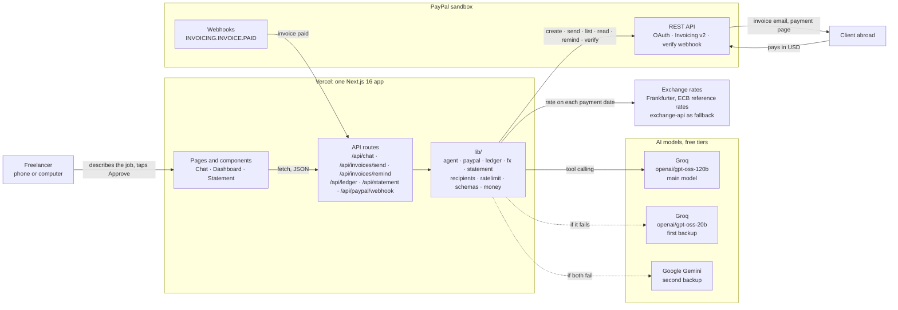

---

## 3. The code map

Who imports or calls whom. Solid arrows are imports; arrows marked `fetch` cross from the browser to the server.

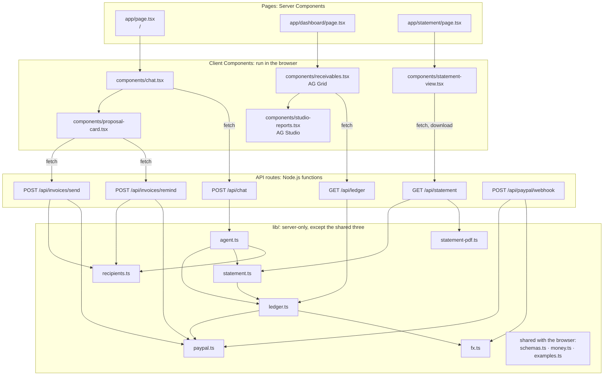

Every route also calls `lib/ratelimit.ts`. The chat and approval routes validate their input with `lib/schemas.ts`, the statement route checks its dates with `isIsoDate`, and the webhook trusts only what PayPal verifies. `import "server-only"` at the top of the server modules makes the build fail if browser code ever imports them, so the PayPal secret and the AI keys can't be bundled into a page.

---

## 4. Flow 1: from plain words to a draft invoice

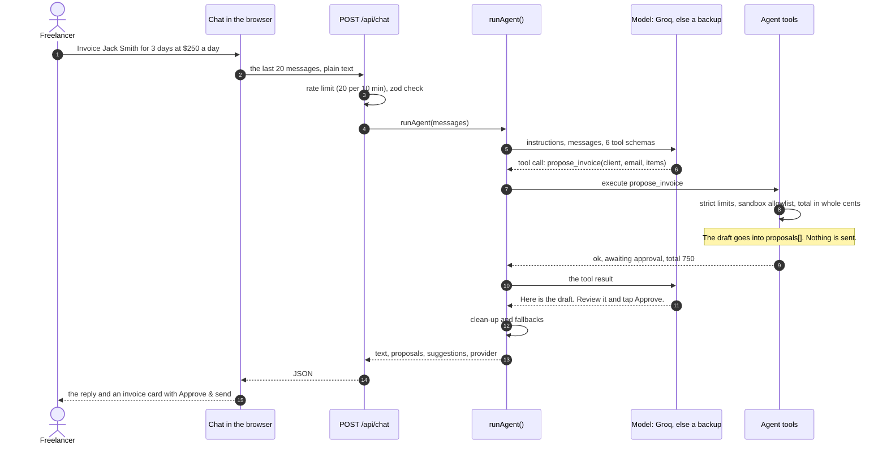

The tool only checks and queues. This is the whole `execute` of `propose_invoice` in `lib/agent.ts`:

```ts
execute: async (input) => {
  const parsed = invoiceProposalSchema.safeParse(input);
  if (!parsed.success) {
    return { ok: false, error: parsed.error.issues.map((i) => `${i.path.join(".")}: ${i.message}`).join("; ") };
  }
  const recipient = checkRecipient(parsed.data.client_email);
  if (!recipient.ok) return { ok: false, error: recipient.error };
  const total = invoiceTotal(parsed.data.items);
  proposals.push({ kind: "invoice", total, data: parsed.data });
  return { ok: true, status: "awaiting_approval", total_usd: total };
},
```

The model turns "3 days at $250 a day" into `quantity: 3, unit_amount: 250` and picks PayPal's unit of measure: `HOURS` for hourly work, `AMOUNT` for a flat fee, `QUANTITY` for anything counted (lessons, words, days). The total is added up in code, in whole cents (`invoiceTotal` in `lib/schemas.ts`).

---

## 5. Flow 2: Approve & send

Sending lives in its own route, reached only from the card's button. The card carries one request id for its whole life, so a double tap or a retry can never create two invoices.

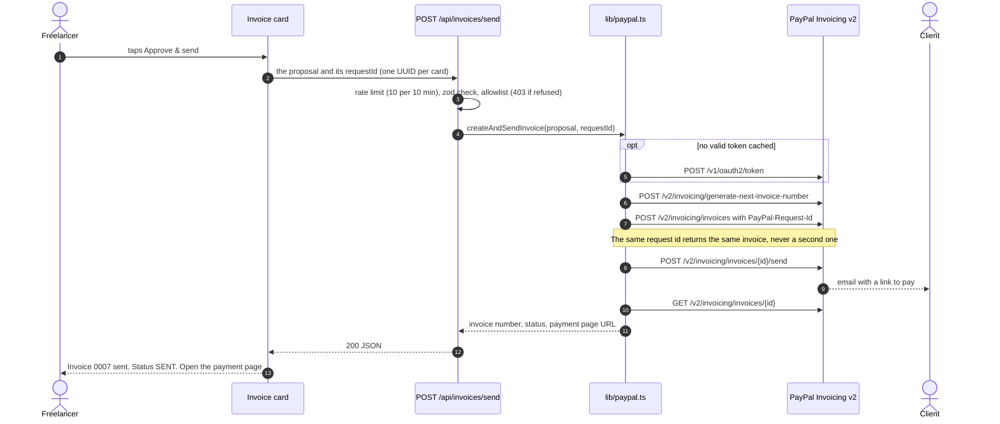

The idempotency key is made once in the browser and sent with the create call:

```tsx
// components/proposal-card.tsx
const requestId = useRef<string>(crypto.randomUUID());
// …
body: JSON.stringify({ proposal: proposal.data, requestId: requestId.current }),
```

```ts
// lib/paypal.ts, createAndSendInvoice()
draft = await paypal<PayPalInvoice>("/v2/invoicing/invoices", {
  method: "POST",
  headers: { Prefer: "return=representation", "PayPal-Request-Id": requestId },
  body: body(true),
});
```

The route trusts nothing from the browser, so the whole proposal is checked again, as if new:

```ts
// app/api/invoices/send/route.ts
const parsed = bodySchema.safeParse(await req.json().catch(() => null));
if (!parsed.success) {
  return NextResponse.json({ error: "Invalid invoice", issues: parsed.error.issues }, { status: 400 });
}
const recipient = checkRecipient(parsed.data.proposal.client_email);
if (!recipient.ok) {
  return NextResponse.json({ error: recipient.error }, { status: 403 });
}
```

Reminders work the same way through `POST /api/invoices/remind`, with one difference: the route reads the invoice from PayPal and checks the email PayPal has on file, so a reminder can only go to the client the invoice was really sent to.

---

## 6. Flow 3: the client pays, the webhook lands

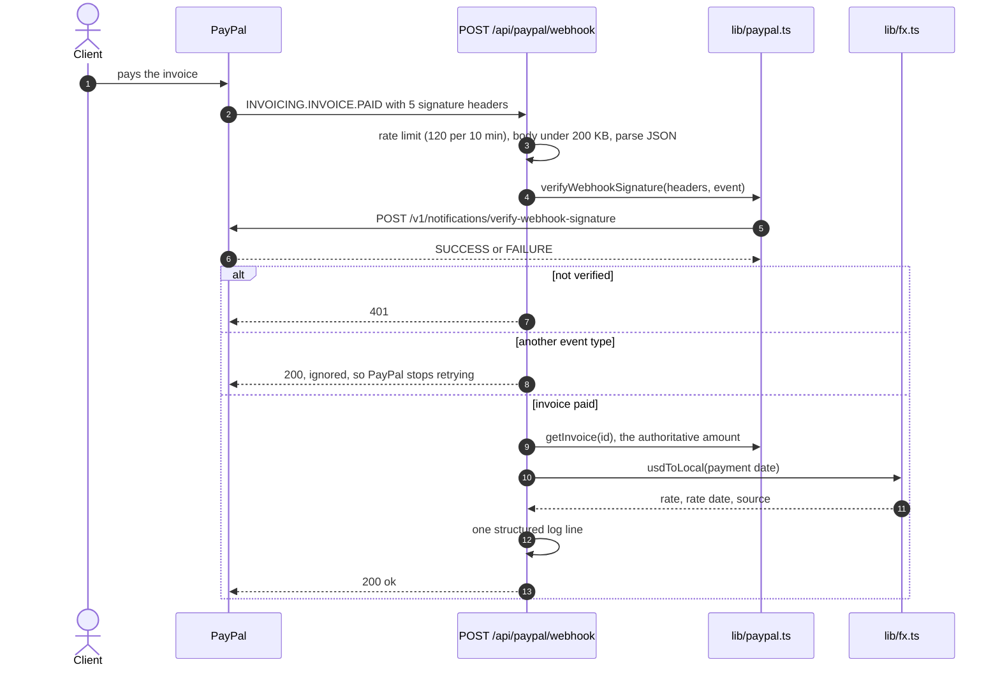

Crossbill doesn't check PayPal's certificate chain itself. It hands PayPal the headers, its webhook id and the exact event, and PayPal answers:

```ts
// lib/paypal.ts
const res = await paypal<{ verification_status: string }>(
  "/v1/notifications/verify-webhook-signature",
  {
    method: "POST",
    body: {
      auth_algo: headers.authAlgo,
      cert_url: headers.certUrl,
      transmission_id: headers.transmissionId,
      transmission_sig: headers.transmissionSig,
      transmission_time: headers.transmissionTime,
      webhook_id: webhookId,
      webhook_event: event,
    },
  },
);
return res.verification_status === "SUCCESS";
```

The webhook stores nothing. The books are rebuilt from PayPal on every request (next section), so the webhook's job is to confirm the payment and log it in local currency.

---

## 7. Flow 4: the books and the exchange rates

`getLedger()` in `lib/ledger.ts` turns PayPal invoices into rows and payments. Every PayPal transaction is its own payment, so each part of a part-paid invoice gets the rate for its own day.

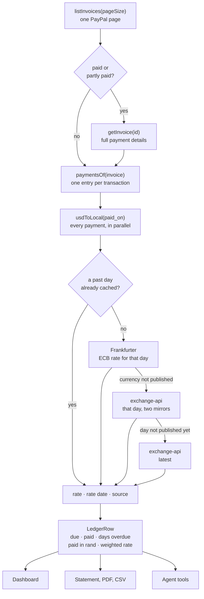

Each payment is converted at its own date:

```ts
// lib/ledger.ts, toRow()
const payments: LedgerPayment[] = await Promise.all(
  paymentsOf(inv).map(async (p) => {
    const fx = await usdToLocal(p.paid_on);
    return {
      // … invoice number, client, date, amount
      fx_rate: fx?.rate ?? null,
      fx_date: fx?.date ?? null,
      fx_source: fx?.source ?? null,
      amount_local: fx ? round2(p.amount_usd * fx.rate) : null,
    };
  }),
);
```

Past rates never change, so they are cached. The cache holds the promise itself, so several payments on the same day share one request, and a failed lookup is dropped so it is tried again next time:

```ts
// lib/fx.ts, usdTo()
const cacheable = day !== "latest" && day < today;
const key = `${cur}:${day}`;
if (cacheable && cache.has(key)) return cache.get(key)!;

const pending = lookup(cur, day);
if (cacheable) {
  cache.set(key, pending);
  pending.then((r) => {
    if (!r) cache.delete(key);
  });
}
return pending;
```

On weekends and public holidays the European Central Bank publishes no rate, so Frankfurter returns the last working day's rate with that day's date. Crossbill keeps both dates, and the statement shows the rate's own date next to the payment date.

---

## 8. Flow 5: the tax statement, PDF and CSV

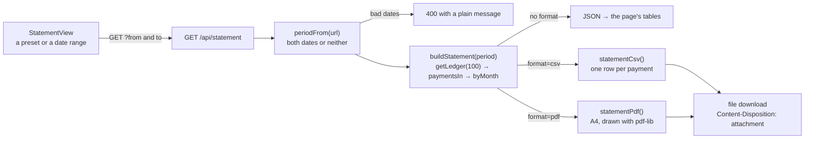

- **The period.** With no dates, the current South African tax year (1 March to the end of February). The presets add last tax year, this month and last month; any range works.
- **The method.** Each payment at the spot rate on the day it was received, the default for individuals in SARS Interpretation Note 63. The statement says so, names the rate sources, and adds that it is a record, not tax advice.
- **The PDF** is drawn on the server, so it downloads the same way on every phone. PDF positions count up from the bottom of the page in points (1/72 inch); the drawing cursor `y` starts at the top and moves down, and a new page starts when space runs out.
- **The CSV** has a UTF-8 byte-order mark (so Excel reads accented names), CRLF line endings and plain numbers, ready for an accountant's spreadsheet.

---

## 9. Flow 6: the dashboard, AG Grid and AG Studio

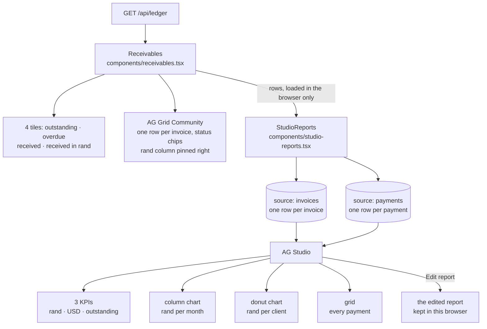

**AG Grid** gets plain rows and column definitions. Value formatters show money and dates while the cell keeps the raw value, so sorting stays numeric. The local-currency column is pinned right, so on a phone it stays in view while the rest scrolls:

```ts
// components/receivables.tsx
{
  field: "paid_local",
  headerName: `Paid (${currency})`,
  width: 130,
  pinned: "right",
  suppressSizeToFit: true,
  filter: false,
  type: "rightAligned",
  valueFormatter: money(currency),
  cellClass: "font-semibold",
},
```

**AG Studio** gets two related sources. Field names carry the currency (`paid_zar`, `usd_zar_rate`), so a freelancer building a report sees meaningful names:

```ts
// components/studio-reports.tsx
return {
  sources: [
    { id: "invoices", data: invoices },
    { id: "payments", data: payments },
  ],
};
```

The ready-made report places six widgets on a 24-column grid. One of them:

```ts
byMonth: {
  type: "column-chart-grouped",
  ...title(`${localWord[0].toUpperCase()}${localWord.slice(1)} received per month`),
  dataMapping: { categoryKey: [{ id: "payments.paid_month" }], valueKey: [paidLocal] },
  sort: [{ field: { id: "payments.paid_month" }, direction: "asc" }],
},
```

AG Studio loads with `next/dynamic` and `ssr: false`, with a skeleton meanwhile, so it stays out of the first page load.

---

## 10. Inside the agent

`runAgent()` in `lib/agent.ts` calls the Vercel AI SDK's `generateText` with the instructions, the conversation and six tools. The model may call tools, read their results and call more, for up to five steps.

Three free models take over from each other: Groq's `openai/gpt-oss-120b`, then Groq's `openai/gpt-oss-20b` (Groq's free limits are per model, so it has its own daily quota), then Google's Gemini, which answers even if Groq itself is down. A rate limit that asks for a wait of 10 seconds or less is waited out once on the same model; anything else moves straight on.

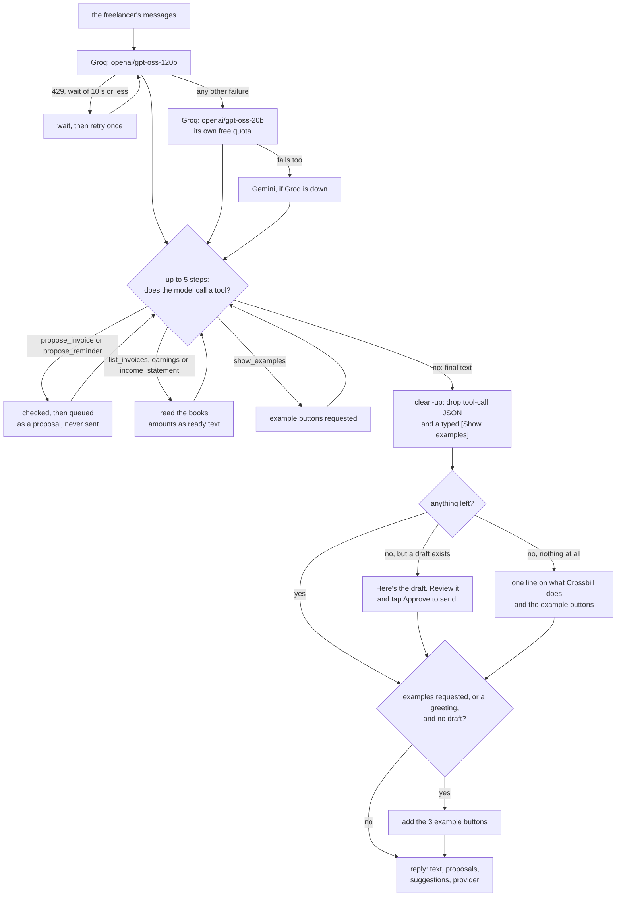

```ts
// lib/agent.ts, runAgent()
const result = await generateText({
  model,
  system: systemPrompt(),
  messages,
  tools: buildTools(proposals, ui),
  stopWhen: stepCountIs(5),
  // Don't retry a provider that has a backup: switching is faster.
  maxRetries: isLast ? 1 : 0,
  temperature: 0.2,
});
```

The six tools:

| Tool | Reads | Writes | Notes |
| --- | --- | --- | --- |
| `propose_invoice` | | a proposal | zod limits, sandbox allowlist, total in cents |
| `propose_reminder` | | a proposal | the recipient is checked on approval |
| `list_invoices` | up to 30 invoices | | amounts as ready text, days overdue |
| `earnings` | up to 50 invoices | | a date range, received and outstanding |
| `income_statement` | up to 100 invoices | | the Statement page's figures by month |
| `show_examples` | | example buttons | for greetings, vague or off-topic messages |

**Guardrails in code, not only in the prompt:**

- No tool sends anything; sending needs a person to tap Approve.
- Every amount the model quotes comes from a tool as ready text (`total_text`, `received_local_text`…), so the model never does currency arithmetic.
- The tool schemas describe each field for the model; the strict limits in `lib/schemas.ts` are checked inside the tools, so a bad value comes back to the model as an error it can fix.
- Models sometimes write a tool call as text. `stripToolJson()` removes such JSON, a typed "[Show examples]" becomes real buttons, and an empty reply gets a useful fallback.
- Low temperature (0.2) for steady, predictable wording.

---

## 11. Safety by design

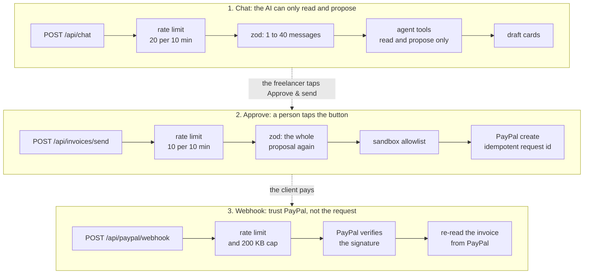

| Risk | What Crossbill does | Where |
| --- | --- | --- |
| The AI sends something by mistake | The agent has no sending tool; separate routes send, and only the Approve button calls them | `lib/agent.ts`, `app/api/invoices/*` |
| A double tap creates two invoices | One request id per card, sent as `PayPal-Request-Id` | `components/proposal-card.tsx`, `lib/paypal.ts` |
| A sandbox invoice to an address that can never pay | Only the listed test clients can receive invoices, checked when drafting and again when approving; with no list, nothing is sent (fail closed) | `lib/recipients.ts` |
| A forged webhook | Accepted only after PayPal verifies the signature; the amount comes from PayPal, not from the request | `app/api/paypal/webhook/route.ts` |
| Bad or oversized input | zod schemas with limits on every request; invoice ids may hold only letters, digits and dashes before they go into a PayPal URL | `lib/schemas.ts` |
| One visitor uses up the free AI quota | Per-IP rate limits on every route | `lib/ratelimit.ts` |
| Secrets in the browser | `import "server-only"` on server modules; keys only in environment variables; `.env.local` is git-ignored | `lib/*.ts` |
| Script injection, framing, sniffing | A content security policy (scripts, styles and fetches from this site only), `frame-ancestors 'none'`, `X-Frame-Options: DENY`, `nosniff`, HSTS, a strict referrer policy | `next.config.ts` |
| Known vulnerable packages | `npm audit --omit=dev` reports 0 vulnerabilities | `package.json` |

---

## 12. The data model

There is no database. These are the shapes the code passes around, all built from PayPal on request.

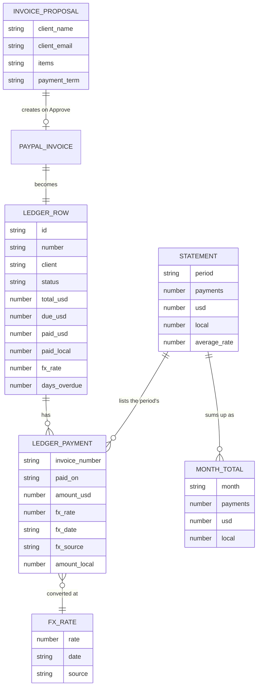

- Money from PayPal arrives as strings (`"70.00"`); `num()` turns it into numbers, and `round2()` rounds to cents whenever amounts are added up.
- Dates are `YYYY-MM-DD` text. In that format text order is date order, so ranges are simple comparisons with no time zones.
- A row's rate is the payment's own rate, or with several payments the weighted average (local ÷ USD), so a row always reconciles with its payments.

---

## 13. In the browser: landing, offline, installable

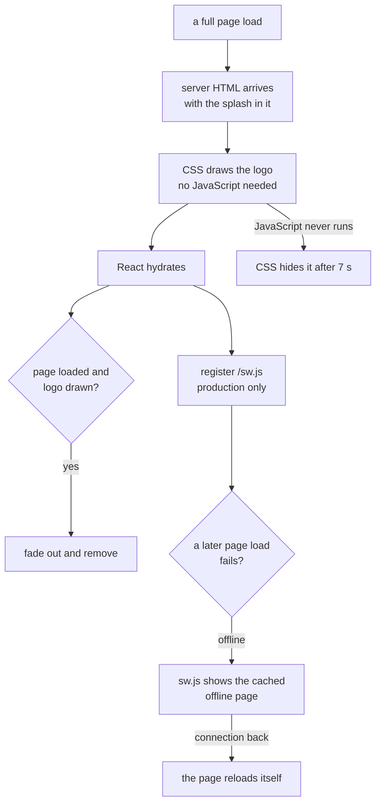

- **Landing animation** (`components/splash.tsx`, `app/globals.css`): part of the server HTML and animated with CSS only, so it paints at once on a slow connection. People who ask for reduced motion see the finished logo without movement.
- **Offline** (`public/sw.js`): the service worker caches one file, `offline.html`. Every other request goes to the network, so invoices, payments and rates are never stale.
- **Installable** (`app/manifest.ts`): name, colours, start page and icons, including a maskable icon for Android.
- **Accessible**: a skip link, visible focus rings, a live region that announces each reply, `aria-current` on the active tab, labelled controls, "opens in a new tab" on external links, and WCAG AA contrast. axe reports no violations on any page.
- **Phone-ready**: works from 320 pixels wide; tables scroll inside their panels, and the rand column stays pinned.

---

## 14. Routes and configuration

### API routes

All rate limits are per IP, per 10 minutes.

| Route | Called by | Limit | Checks | Calls |
| --- | --- | --- | --- | --- |
| `POST /api/chat` | `components/chat.tsx` | 20 | `chatRequestSchema` | `runAgent()` |
| `POST /api/invoices/send` | the invoice card | 10 | `invoiceProposalSchema`, UUID request id, allowlist | `createAndSendInvoice()` |
| `POST /api/invoices/remind` | the reminder card | 10 | `reminderProposalSchema`, allowlist on PayPal's email | `getInvoice()`, `sendReminder()` |
| `GET /api/ledger` | `components/receivables.tsx` | 30 | | `getLedger(50)`, `totals()` |
| `GET /api/statement` | `components/statement-view.tsx` | 30 | real dates, from ≤ to | `buildStatement()`, CSV, PDF |
| `POST /api/paypal/webhook` | PayPal | 120 | 200 KB cap, PayPal signature | `verifyWebhookSignature()`, `getInvoice()`, `usdToLocal()` |

### Environment variables

Set in `.env.local` locally (git-ignored) and in the Vercel project settings.

| Variable | Read in | Purpose |
| --- | --- | --- |
| `PAYPAL_CLIENT_ID`, `PAYPAL_CLIENT_SECRET` | `lib/paypal.ts` | OAuth for every PayPal call |
| `PAYPAL_API_BASE` | `lib/paypal.ts` | Sandbox by default; the live URL switches off the allowlist |
| `PAYPAL_WEBHOOK_ID` | `lib/paypal.ts` | Needed to verify webhook signatures |
| `SANDBOX_TEST_EMAILS` | `lib/recipients.ts` | The test clients that may receive invoices |
| `AI_PROVIDER_ORDER`, `GROQ_API_KEY`, `GROQ_MODEL`, `GROQ_SMALL_MODEL`, `GOOGLE_GENERATIVE_AI_API_KEY`, `GEMINI_MODEL` | `lib/agent.ts` | Which models, in which order (default `groq,groq-small,gemini`) |
| `DEFAULT_PAYMENT_TERM` | `lib/paypal.ts` | Due terms when the agent doesn't set them |
| `LOCAL_CURRENCY` | `lib/fx.ts` | The currency of the books (default ZAR) |
| `BUSINESS_NAME` | `lib/paypal.ts`, `lib/statement.ts` | The name on invoices and the statement |

### Build and deployment

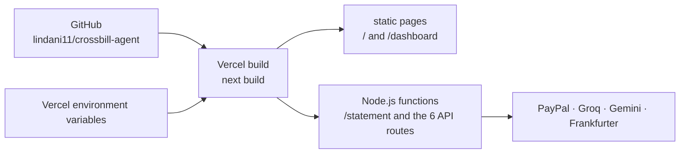

The chat and dashboard pages are static HTML; their data arrives through the API routes. The statement page is rendered per request because it reads the dates in its URL.

---

## 15. Design decisions

| Decision | Why | Trade-off |
| --- | --- | --- |
| **No database** | PayPal is the source of truth, so the books can't drift out of sync, and there is nothing to host, migrate or pause | Each request re-reads PayPal; see the limitations |
| **Approval enforced by tool design** | A prompt that says "ask first" is a request; a model with no sending tool can't send | One extra tap per invoice, which is the point |
| **One rate per payment date** | SARS Interpretation Note 63 translates foreign income at the spot rate on the day it is received, and part-payments arrive on different days | One rate lookup per distinct day (cached) |
| **The model never does arithmetic** | Language models are good at structure and unreliable at sums | Tools return more fields (`*_text`) |
| **Three AI models, two providers** | Free tiers run out. Groq's limits are per model, so its smaller model adds a second daily quota, and Gemini answers even if Groq itself is down | Replies can differ slightly by model; each reply shows which one answered |
| **A PDF built on the server** | The browser's print dialog behaves differently on every phone | A small PDF library (pdf-lib) on the server |
| **A sandbox allowlist** | PayPal has no API that says whether an email belongs to a PayPal account | Only listed test clients on the sandbox; any address in live mode |
| **Rate limits and caches in memory** | Free and simple for a demo | Per server instance, reset on a cold start |
| **A CSS-only landing animation** | It paints before any JavaScript arrives | Its timing is set in CSS as well as in the component |
| **A service worker that caches one page** | An offline page without the risk of showing stale money figures | No offline use of the app itself |

---

## 16. Known limitations and what's next

| Limitation today | Next step |
| --- | --- |
| Reads one page of invoices: the dashboard 50, the statement 100, the agent's list 30 | Follow PayPal's pagination and keep a summary per invoice |
| Paid invoices are re-read one by one on each request | Cache each invoice until PayPal's webhook says it changed |
| Rate limits and caches are per server instance | A shared store such as Upstash Redis |
| Sandbox only, one freelancer per deployment | Live mode with Log in with PayPal, one account per freelancer |
| An open dashboard doesn't update by itself when a payment lands | Push the webhook's news to open pages, or refresh on focus |
| Free AI quotas reset daily; a very busy day could use up all three | A paid tier, or more providers in the same fallback chain |
| The spot-rate method only | Also offer the SARS average-rate election for the tax year |
| With a currency other than ZAR, the statement still opens on the South African tax year until a preset or range is picked | Open on the calendar year for other currencies |

---

## 17. Reading the code: a learning path

Every file opens with a header (what it does, how it connects, key ideas), and the less obvious lines carry short comments explaining why. A good order to read it in:

1. `lib/schemas.ts`: zod shapes that both validate and type the data.
2. `lib/agent.ts`: tool calling with the Vercel AI SDK, guardrails, provider fallback.
3. `app/api/chat/route.ts`, then `components/chat.tsx`: one turn of the conversation, end to end.
4. `components/proposal-card.tsx`, then `app/api/invoices/send/route.ts`: human approval and idempotency.
5. `lib/paypal.ts`: OAuth, the fetch wrapper, Invoicing v2 and webhook verification.
6. `lib/ledger.ts` and `lib/fx.ts`: books without a database, rates per payment day, promise caching.
7. `lib/statement.ts` and `lib/statement-pdf.ts`: a tax statement as JSON, CSV and a hand-drawn PDF.
8. `components/receivables.tsx` and `components/studio-reports.tsx`: AG Grid and AG Studio.
9. `app/api/paypal/webhook/route.ts`: trusting PayPal rather than the request.
10. `next.config.ts`, `public/sw.js`, `components/splash.tsx`: security headers, offline, first paint.

| File | In one line |
| --- | --- |
| `app/layout.tsx` | Wraps every page: splash, service worker, footer |
| `app/page.tsx` | The Chat page |
| `app/dashboard/page.tsx` | The Dashboard page |
| `app/statement/page.tsx` | The Statement page; checks the dates in its URL |
| `app/manifest.ts` | The web app manifest |
| `app/globals.css` | Design tokens, components, animations, print styles |
| `app/api/chat/route.ts` | One conversation turn |
| `app/api/invoices/send/route.ts` | Create and send, on Approve only |
| `app/api/invoices/remind/route.ts` | Remind, on Approve only |
| `app/api/ledger/route.ts` | The books for the Dashboard |
| `app/api/statement/route.ts` | The statement as JSON, CSV or PDF |
| `app/api/paypal/webhook/route.ts` | Verified payment events |
| `components/chat.tsx` | Messages, examples, the growing input |
| `components/proposal-card.tsx` | The draft and its Approve & send |
| `components/receivables.tsx` | Tiles and the AG Grid table |
| `components/studio-reports.tsx` | The AG Studio report |
| `components/statement-view.tsx` | Periods, tables, downloads |
| `components/splash.tsx` | The landing animation |
| `components/logo.tsx` | The Crossbill mark as SVG |
| `components/site-header.tsx`, `site-footer.tsx` | Skip link, tabs; footer and video link |
| `components/service-worker.tsx` | Registers `public/sw.js` |
| `lib/agent.ts` | The AI agent |
| `lib/paypal.ts` | The PayPal REST client |
| `lib/ledger.ts` | The books |
| `lib/fx.ts` | Exchange rates |
| `lib/statement.ts`, `lib/statement-pdf.ts` | The statement, its CSV and its PDF |
| `lib/recipients.ts` | The sandbox allowlist |
| `lib/ratelimit.ts` | Per-IP rate limits |
| `lib/schemas.ts` | zod schemas and types |
| `lib/money.ts` | Money, dates and tax years |
| `lib/examples.ts` | The three example prompts |
| `public/sw.js`, `public/offline.html` | The offline page |
| `next.config.ts` | Security headers |

---

## 18. Glossary

| Term | Meaning here |
| --- | --- |
| **Agent** | A language model that can call tools (functions in our code) and use their results before it replies |
| **Tool calling** | The model returns a tool name and arguments that match a schema; our code runs the tool and sends back the result |
| **Proposal** | A draft invoice or reminder waiting for the freelancer's approval |
| **Idempotent** | Doing it twice has the same effect as doing it once; here, the same request id never creates a second invoice |
| **Webhook** | PayPal calling our URL when something happens, here when an invoice is paid |
| **Signature verification** | Asking PayPal to confirm a webhook really came from PayPal for our webhook id |
| **Spot rate** | The exchange rate on a given day |
| **SARS Interpretation Note 63** | South African Revenue Service guidance on translating foreign-currency amounts into rand |
| **Tax year (South Africa)** | 1 March to the end of February; the 2027 tax year ends in February 2027 |
| **Server Component** | A React component that renders on the server and sends HTML, with no JavaScript of its own |
| **Client Component** | A React component that also runs in the browser (`"use client"`), for state and events |
| **Sandbox** | PayPal's test environment: real APIs, test accounts, no real money |

---

<p align="center"><a href="../README.md">Back to the README</a></p>
